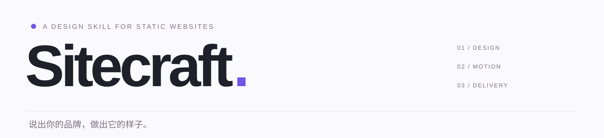
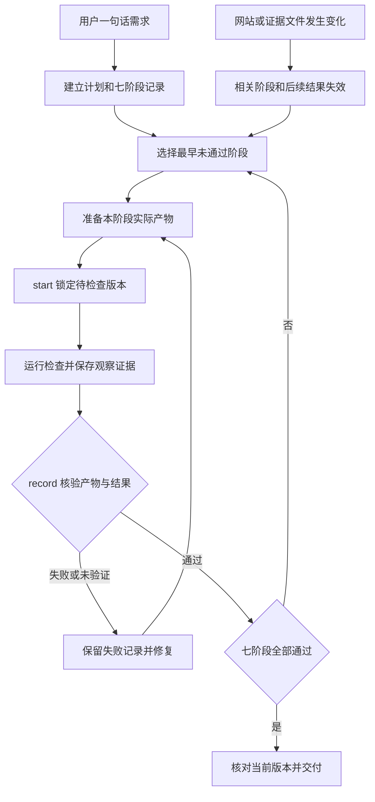
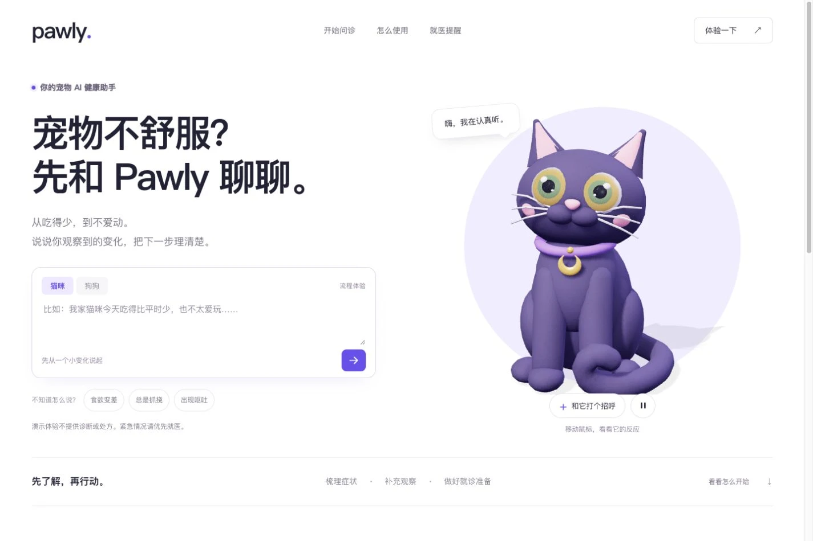
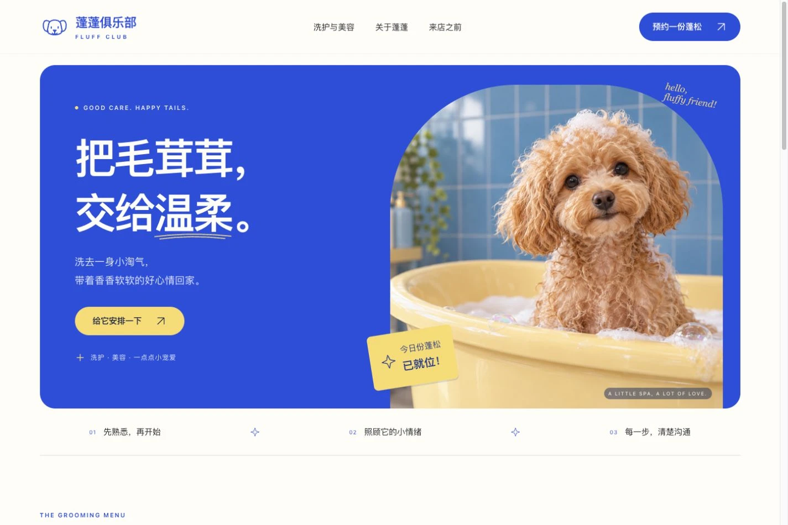
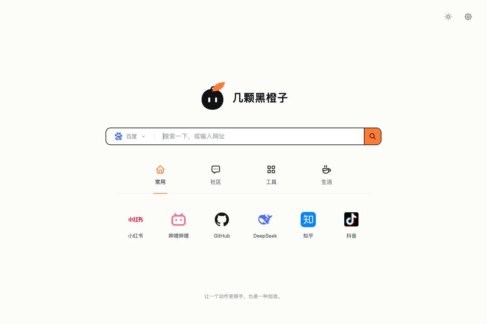

<p align="center">
  
</p>
<p align="center">
  <a href="https://github.com/zcjunblog/sitecraft/releases/latest"></a>
  
  
  <a href="LICENSE"></a>
</p>
<h1 align="center">不懂技术，也能把品牌官网做得漂亮。</h1>
<p align="center">用几句日常的话说出你的想法。<br>让 AI 帮你完成有品牌感的画面、顺手的交互和手机布局。</p>
<p align="center">
  <a href="#解决哪些问题">解决哪些问题</a> ·
  <a href="#产出示例">看看效果</a> ·
  <a href="#一句话开始">怎么使用</a> ·
  <a href="#安装">安装</a> ·
  <a href="#历史作品参考">历史作品</a>
</p>

你可能很清楚自己想要什么：花店要浪漫大气，宠物门店要干净亲切，自己的品牌要让人记得住。可一到做官网，就卡在配图、排版、颜色和动画上。

**Sitecraft 最想解决的，就是这件事：哪怕不会写代码、不懂网页设计，也能通过简单几句话，把品牌官网做得漂亮、有自己的气质。**

它是一套给 AI 使用的官网设计 Skill。你负责说清品牌、用途和喜欢的感觉，AI 按这套方法查找参考、组织页面、处理素材，再把实际画面打开检查和修改。你也可以继续用“再大气一点”“手机上字太小了”这样的日常反馈调整。

## 解决哪些问题

| 你遇到的问题 | Sitecraft 帮你怎样解决 |
| --- | --- |
| 有品牌、有想法，却不会把它做成网页 | 从几句业务描述开始，由 AI 补足页面组织和设计细节，做出可以打开预览的官网。 |
| AI 做出来很整齐，却一眼像通用模板 | 结合品牌与实际素材看参考，重新决定配色、字体和构图，减少跨行业重复套用同一种外观。 |
| 想要“简约、大气、亲切”，说不出设计术语 | 把这些感受落实到主体大小、文字主次、图片和留白，不要求你先写专业设计简报。 |
| 首屏不错，往下看却粗糙；电脑好看，手机拥挤 | 检查整页与手机画面，重新安排内容和操作，而不只美化一张封面。 |
| 想要灵动的效果，却只得到生硬动画和不协调的弹窗 | 让角色动作、页面切换、光影以及按钮和菜单的状态共同服务当前主题。 |
| 想把产品或角色做成能互动的 3D 首屏 | 按需求制作立体空间、可拖动的产品模型或会跟随指针的角色，保留手机和无 WebGL 环境也能浏览的页面。 |
| 拿到一堆代码，不知道能不能交付 | 整理完整静态文件，检查图片、包体和资源是否齐全，并提供预览与部署说明。 |

适合想展示产品、服务或作品的品牌主理人、门店经营者、创作者与小团队。正式接入订单、支付、会员或 AI 服务时，再按实际业务补充相应系统。

做新官网时，Sitecraft 会从真实案例中确定主体、光线、字体和构图的搭配，再做可操作的桌面与手机首屏。先检查主按钮的位置与实际目标、图片和字体加载，再看画面并修订。比较两稿时固定品牌、文案和主图，核对构图与排字的变化。[查看设计流程](skills/sitecraft/references/delivery-workflow.md)

### 参考如何变成页面

当前开发改动把参考整理为可执行设计资产：**实际截图 → 设计关系与适用条件 → 项目的中文、主图和两端目标 → 可改写的 HTML/CSS → 参考与实际首屏对照 → 问题修复与复看**。

内置五种起点：单一实物、沉浸场景、产品工作画面、内容目录、商品与中文标题。每例附来源与观察范围、可借鉴和不借用的部分、两端实现参数和原创代码。AI 按任务、品牌与素材选择；已有品牌优先，无匹配时另找实际作品，不要求所有官网采用同一构图。

视觉检查将参考和当前桌面/手机截图并排呈现，对照构图、中文排字、主体裁切、光线材质、主要行动和手机重排。每项记录具体观察与取舍；已发现的问题需要保留修复前后图和复看。工具负责核对证据，视觉判断仍须实际看图。

0.4.0 已在本机 WorkBuddy 完成同模型、固定内容的花店对照：首稿的主体尺度、手机花束可见范围和装饰克制有局部改善，后续视觉检查还自行发现并修复了裁切问题。**没有证明更省时，也不能保证每次都得到漂亮的首稿**；模型仍会花较多时间查文档，组装器的生成收益尚未单独证实。[查看真实截图、过程与限制](docs/validation/0.4.0.md) · [资产与使用方式](skills/sitecraft/references/executable-design-assets.md) · [案例数据](skills/sitecraft/references/design-assets.json) · [原创布局代码](skills/sitecraft/assets/hero.css)

整站资产提供导航、手机菜单、商品/作品目录、服务清单、联系入口与完整组合示例，可按实际内容取用。检查工具可定位并复用已有环境，从本轮报告自动归集截图与阶段字段；视觉观察仍由实际评审填写。[查看完整组件示例](skills/sitecraft/assets/example.html) · [组装与自动化](skills/sitecraft/references/assembly-and-automation.md)

WorkBuddy 发行包 0.4.1 仅补充市场展示元信息和验证材料链接，Skill 正文及其余运行文件沿用已验证的 0.4.0；[查看发布修正说明](docs/validation/0.4.1.md)。

## 一句话之后，怎样推进到交付

AI 按七个阶段完成制作，每阶段留下实际产物和检查结果。阶段工具核对前置条件、文件与版本，失败或未验证时保留问题并修复复验。你仍用日常语言描述需求，流程记录和工具调用由 AI 完成。

| 阶段 | 可以查看的产物与结果 |
| --- | --- |
| 需求计划 | 原始需求、受众、主要动作、内容、效果范围与性能预算 |
| 参考选型 | 实际参考图、来源、项目设计计划、两端目标与实现位置 |
| 首屏实现 | 可操作入口、桌面和手机首屏、浏览器检查报告 |
| 视觉评审 | 参考与成品并排对照、两端逐项观察、问题修复前后图和复看结果 |
| 整站与交互 | 整页截图、控件操作记录、Motion / 转场 / 光影中间帧、减少动态效果与适用的 3D 检查 |
| 首页速度 | 桌面与手机各三次冷访问、一次热访问，以及逐样本预算检查 |
| 最终交付 | 部署包、文件与图片审计、独立解压预览、使用说明和当前版本验收状态 |



代码、图片或证据改变后，相关阶段及后续结果需要重验，失败尝试保留在记录中。最终包必须与已审计目录同版，并从独立解压目录复验。视觉与动态评审需要 AI 实际观察，流程工具负责核对文件、顺序和声明的检查结果。本轮验证的作用与尚未覆盖的范围见[验证记录](docs/validation/0.4.0.md)，技术通过不等于审美保证。[查看执行约束与命令](skills/sitecraft/references/workflow-contract.md)

## 产出示例

宠物门店、鲜花零售、兴趣社区和宠物健康助手，各自有不同的样子。下面的截图来自实际运行的网页，点击可查看大图；对应源码与成品也一并开源。

<table>
<tr>
<td width="50%" valign="top">
<a href="docs/images/pawly.webp"></a>
<h3>Pawly · 宠物 AI 问诊</h3>
<p>一句“放一只会跟着鼠标转头的 3D 猫咪”，落实成能打招呼、会点头的首页角色，并配上可操作的问诊演示。</p>
<p><a href="examples/pawly">查看源码与运行说明 →</a></p>
</td>
<td width="50%" valign="top">
<a href="docs/images/fluff-club.webp"></a>
<h3>蓬蓬俱乐部 · 宠物洗美</h3>
<p>让顾客一眼感受到干净、亲切和轻松。服务介绍、预约体验和手机浏览一起完成。</p>
<p><a href="examples/fluff-club">查看源码与运行说明 →</a></p>
</td>
</tr>
<tr>
<td width="50%" valign="top">
<a href="docs/images/jigen-station.webp"></a>
<h3>次元站 · 二次元聚集地</h3>
<p>把“想做一个二次元聚集地”变成能走进的海边站台、放映室与画室，页面随着浏览展开。</p>
<p><a href="examples/jigen-station">查看源码与运行说明 →</a></p>
</td>
<td width="50%" valign="top">
<a href="docs/images/zhijian-florist.webp"></a>
<h3>枝间 · 鲜花零售</h3>
<p>把“白底、简约、大气、表达爱情”落实成自然红玫瑰与醒目的标题，让挑花和整理花单也顺手。</p>
<p><a href="examples/zhijian-florist">查看源码与运行说明 →</a></p>
</td>
</tr>
</table>

> 这些页面经过不同版本的迭代和反馈，并非全部由当前版本一次生成。Pawly 是静态问诊流程演示，未连接真实 AI 或兽医；其余示例的预约、社区、价格与订单也属于演示设定。具体边界见各自 README。

## 一句话开始

先在支持 Skill 的 Codex 中安装 Sitecraft，再像和设计伙伴聊天一样描述需求：

```text
用 Sitecraft 帮我做一个宠物洗美门店官网。
想要明亮、干净、有亲和力，让顾客一眼看懂服务，也方便联系我。
```

也可以更简单：

```text
用 Sitecraft 做一家鲜花零售门店的品牌官网，简约、大气、有浪漫感。
```

看过预览后，继续说你的感受：

```text
这个颜色不太像我的品牌，想更明亮一些。
首页的花束可以再大一点，手机上也要看得舒服。
```

不必先决定用什么框架、写哪些 CSS 或选哪套动画库。有 Logo、产品图或参考页面时直接提供；只有业务描述时，AI 也应先作合理设计并完成预览。

自然语言可以说“用 Sitecraft”或“用官网设计”；想明确指定技能时使用 `$sitecraft`。技能也提供“静态官网”“企业官网”“静态网页”“纯静态”“官网”等选择线索，具体是否自动加载由宿主与模型决定。

## 安装

在 Codex 对话里说：

```text
请从 https://github.com/zcjunblog/sitecraft 安装 skills/sitecraft 这个 Skill。
```

安装完成后，在下一轮对话中使用。你需要已有可使用 Skill 的 Codex 环境；正式上线还涉及域名与托管，可以继续让 AI 协助处理。

### 通过 Skills CLI 安装

如果已有 Node.js 和 npm，也可以在终端运行这条已实际验证的命令：

```sh
npx skills add zcjunblog/sitecraft --skill sitecraft
```

按提示选择 Codex 和安装范围，看到 `Installation complete` 即表示安装完成。CLI 默认安装到当前项目；希望跨项目使用时加上 `-g`：

```sh
npx skills add zcjunblog/sitecraft --skill sitecraft -g
```

CLI 后续可能推荐安装 `find-skills`，它是另一个可选技能，Sitecraft 不依赖它。若安装后宿主未显示 Sitecraft，重新加载或重启宿主后再查看。

[在 skills.sh 查看 Sitecraft](https://www.skills.sh/zcjunblog/sitecraft/sitecraft)

<details>
<summary>熟悉终端的话 也可以手动安装</summary>

需要 Git 和 Python 3.9+，在终端运行：

```sh
git clone https://github.com/zcjunblog/sitecraft.git
python3 sitecraft/tools/install.py
```

默认安装到 `~/.codex/skills/sitecraft`；设置了 `CODEX_HOME` 时安装到其 `skills/` 目录。安装器仅复制 Skill，已有版本会备份到技能目录之外，不会把示例、截图展示页和开发依赖一起装入。安装后在下一轮对话中调用。

[下载独立 Skill 压缩包](https://github.com/zcjunblog/sitecraft/releases/latest/download/sitecraft.zip) · [查看安装器](tools/install.py)

</details>

## 为了让官网好看 它会帮你做什么

| 环节 | 具体做什么 |
| --- | --- |
| 看实际参考 | 查看相关品牌画面和当前素材，分析主体尺度、图文关系、材质与阅读顺序。内置实图包含不同方向，也保留被否定的案例。 |
| 决定构图 | 从访问目的和内容确定表达。新建官网默认采用与主题相符的沉浸体验；配色、字体与密度随项目变化。必要时先比较少量真实首屏小样。 |
| 做完整交互 | 设计按钮、下拉、弹层与表单的实际状态，核对键盘、焦点与手机操作。默认不使用 Emoji 充当 UI 装饰。 |
| 分别做动态 | 场景 Motion、连续转场、动态光影各自承担作用；支持暂停、离屏处理和减少动态效果。 |
| 看画面再修订 | 查看桌面、手机和重要展开状态；将任务清晰度与视觉完成度分开评审，首次交付包含内部修订。 |
| 按部署包验收 | 检查图片处理、标准压缩、版本化资源、包体积及资源完整性，再从最终包预览和测量首页加载。 |

Skill 通过说明、参考图和可执行检查器指导制作。成品仍取决于模型、素材、浏览器能力和实际修订；当前案例不足以证明每个主题都能一次命中审美，也不以测试全绿替代视觉判断。

## 历史作品参考

下面两个网站是作者已有作品，为 Skill 提供制作经验与质量参照。此处展示截图和访问入口，不声称它们由当前 Skill 重新生成，也不包含这两个网站的源码。

<table>
<tr>
<td width="50%" valign="top">
<a href="https://nav.gs/"></a>
<h3>nav.gs · 简约导航</h3>
<p>让搜索和常用入口直接成为页面主体。</p>
<p><a href="https://nav.gs/">访问网站 ↗</a></p>
</td>
<td width="50%" valign="top">
<a href="https://jkhcz.com/"></a>
<h3>jkhcz.com · 几颗黑橙子</h3>
<p>角色、场景、排字与交互共同表达创作空间。</p>
<p><a href="https://jkhcz.com/">访问网站 ↗</a></p>
</td>
</tr>
</table>

截图采集于 2026-11-03；线上内容可能继续更新。[截图与素材来源](docs/asset-provenance.md)

## 示例源码与开发说明

四个示例都提供可编辑源码、就绪静态成品和独立说明，方便进一步学习、修改或部署。

### 本地查看示例

无需先构建，仓库已经包含静态成品：

```sh
cd sitecraft
python3 -m http.server 8080 --directory examples/pawly/site
```

打开 `http://127.0.0.1:8080/`，将目录替换为下表路径即可切换项目：

| 示例 | 静态成品 | 可编辑源码 |
| --- | --- | --- |
| Pawly | [`examples/pawly/site`](examples/pawly/site) | [`source`](examples/pawly/source) |
| 蓬蓬俱乐部 | [`examples/fluff-club/site`](examples/fluff-club/site) | [`source`](examples/fluff-club/source) |
| 次元站 | [`examples/jigen-station/site`](examples/jigen-station/site) | [`source`](examples/jigen-station/source) |
| 枝间花店 | [`examples/zhijian-florist/site`](examples/zhijian-florist/site) | [`source`](examples/zhijian-florist/source) |

本地 HTTP 服务只负责提供文件，运行这些页面不需要 Node 后端或数据库。修改源码后，在对应示例目录执行 `npm ci && npm run build`；具体 Node 要求见各示例说明。正式部署上传 `site/` 的内容。

<details>
<summary>仓库结构 验证与贡献</summary>

## 仓库结构

```text
sitecraft/
├── skills/sitecraft/       技能入口、参考图、设计资产、检查器与维护用例
├── examples/              四个示例的 source、site 和构建说明
├── docs/images/           README 实际网页截图
├── tools/                 安装、打包与仓库检查
├── THIRD_PARTY_NOTICES.md  第三方素材与许可边界
└── LICENSE                自有代码和文档的 MIT 许可
```

## 验证与贡献

```sh
python3 tools/check_repository.py
python3 -B -m unittest discover -s skills/sitecraft/tests -p 'test_*.py'
```

已有 Playwright 与浏览器时，可运行浏览器检查器的回归用例。将模块路径换成当前环境的实际位置。

```sh
PLAYWRIGHT_MODULE=/path/to/node_modules/playwright \
  node --test skills/sitecraft/tests/review_site.test.mjs skills/sitecraft/tests/measure_page.test.mjs skills/sitecraft/tests/components.test.mjs
```

首屏用例覆盖手机入口位置、目标缺失或无法到达、遮挡、演示弹层、图片与字体解码失败，以及旧的整页检查入口。用例通过证明检查器能识别这些问题，视觉质量仍需查看实际画面。

静态发布检查器与首页性能工具位于 [`skills/sitecraft/scripts`](skills/sitecraft/scripts)，完整操作见[静态发布规范](skills/sitecraft/references/static-release.md)。性能工具需要调用者已有的 Playwright 与浏览器，不会自动安装；本地测量不能当成线上速度。

阶段工具 `workflow.py` 使用 Python 标准库，维护回归覆盖跳步、缺证据、未验证结果、失败重试、报告过期、版本变更、动效序列、性能预算、最终包与独立预览，以及离线 HTML。运行方式包含在上面的 Python 测试命令中。[阶段契约](skills/sitecraft/references/workflow-contract.md)

欢迎提交带有**原始需求、实际截图、问题位置与修改后对照**的 Issue 或 PR。新增案例请说明适用条件和局限，不把某个品牌的颜色或字体固化为所有项目的答案。


</details>

## 许可

自有代码、脚本与文档采用 [MIT License](LICENSE)。第三方库、CC0 猫咪模型、品牌参考截图和示例图像按各自来源与说明处理；MIT 不授予第三方品牌资产的再利用权。详见 [THIRD_PARTY_NOTICES.md](THIRD_PARTY_NOTICES.md) 与[素材溯源](docs/asset-provenance.md)。

<p align="center">Created by <a href="https://github.com/zcjunblog">zcjunblog</a> · <a href="https://jkhcz.com/">几颗黑橙子</a></p>
