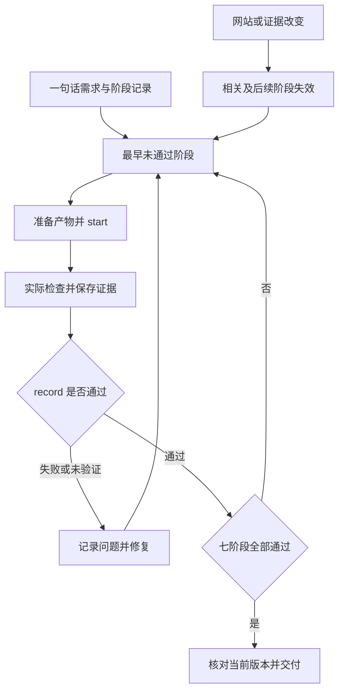

# Sitecraft · 官网设计

从一句话做出可打开的静态官网。适用于静态官网、企业官网、静态网页、纯静态、官网设计和 3D 首屏。用户说“用 Sitecraft”或“用官网设计”时直接按其请求处理。用户只问方法或要求局部修改时按当前范围处理。

新建或整体重做时先读 @references/workflow-contract.md，使用 `python3 scripts/workflow.py init` 建立七阶段记录。按需求计划、参考选型、首屏、视觉评审、整站与交互、性能、最终包推进。每阶段准备实际产物后 `start`，实际检查并保存证据，再 `record`。失败或未验证就修复复验，前置未通过无法推进。网站或证据变化后重新验收失效阶段，最终执行 `status --require-complete` 核对当前版本。

先读 @references/delivery-workflow.md，按当前主题制作实际入口。视觉评审保存真实桌面和手机截图；Motion、转场、光影分别记录动态中间帧与实际观察。缺工具保留未通过状态和阻塞原因。

1. 根据现有内容确定访客的主要动作和用户最在意的气质。新项目先选一个看过的主案例，说明主体、光线或材质和排字如何一起表达气质。第二个案例仅用于一个明确缺口。把决定写成三行可在画面中核对的要求。缺少真实资料时用明确标注的演示内容。
2. 首次写出的实际入口同时包含手机布局、主按钮的目标内容、主图和所用字体。页内跳转的目标和演示弹层在首屏阶段就可操作。首屏前至多发起一次主视觉生成。工具安装、批量素材和抠图返工排在可打开首屏之后。普通配色、字体与品牌名由执行者自行决定。
3. 按阶段契约运行 `python3 scripts/workflow.py check --tool browser`，同时传入运行目录、实际主操作选择器与已有浏览器模块。工具启动当前目录并采集桌面、手机报告，核对主操作可达与资源加载。修好失败项并复验登记，再评图、字和构图的配合。已有旧稿的对照先固定品牌、文案和主图，修复主要问题并复看，通过后再扩展整站。缺验证环境保留阶段未通过和阻塞原因。

新站默认按主题安排沉浸式表达，分别考虑场景动效、真实状态的连续转场与光影变化。尊重明确要求和减少动态效果偏好。默认用一致的图标，真实 3D、角色跟随和产品旋转读 @references/web-3d.md。下拉、弹层和菜单的实际展开状态读 @references/motion-and-controls.md，整页复查读 @references/visual-review.md。

交付静态部署包时，读 @references/static-release.md，从成品中检查图片、相对路径、归档和首页加载。独立静态页面不依赖常驻服务。只有文本工具时可提供当前完整 HTML，并保留尚未验证阶段的真实状态。
