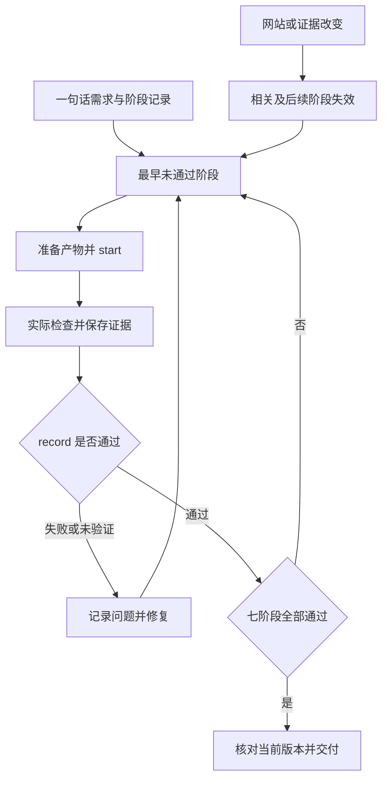

# Sitecraft · 官网设计

从一句话做出可打开的静态官网。适用于静态官网、企业官网、静态网页、纯静态、官网设计和 3D 首屏。用户说“用 Sitecraft”或“用官网设计”时直接按其请求处理。用户只问方法或要求局部修改时按当前范围处理。

新建或整体重做先读 @references/quickstart.md，看图选型并写实际首屏。优先改编合适的原创组合资产；已有品牌或资产不适配时自行实现并说明差异。workflow.py init 会提供需求草稿。七阶段约束验收顺序，不要求先填完所有记录才写网页：每阶段 start → 实际 check/观察 → prepare 自动整理 → record。当前阶段细节查 @references/workflow-contract.md。失败或未验证就修复复验，前置未通过不能推进；网站或证据变化后重验失效阶段，最终 status --require-complete 核对当前版本。

先读 @references/delivery-workflow.md，按当前主题制作实际入口。视觉评审保存真实桌面和手机截图；Motion、转场、光影分别记录动态中间帧与实际观察。缺工具保留未通过状态和阻塞原因。

整站资产与快捷命令读 @references/assembly-and-automation.md。使用原创区块或自行实现，按当前内容选择组合；可用 design_assets.py assemble 从项目数据生成完整站。入口写好后用 workflow.py doctor 复用现有环境；check 可识别唯一 data-sitecraft-primary 页内动作，prepare --observations 自动归集本轮报告、截图与阶段字段。用真实观察填写设计判断，不手抄哈希，不读源码猜命令参数；缺证据仍不能登记通过。

1. 根据现有内容确定访客的主要动作和用户最在意的气质。先读 @references/executable-design-assets.md，实际打开相关案例，按任务、素材和气质选择可执行构图资产。用 design_assets.py 形成 design-plan.json，把实际主图、中文标题、两端尺度/断行/裁切/行动及借鉴边界落实到代码位置。可用随包原创 HTML/CSS 骨架，也可自行实现；无匹配时查真实作品并建立 custom 计划。关键词命中不能替代看图选型。缺少真实资料时用明确标注的演示内容。
2. 首次写出的实际入口同时包含手机布局、主按钮的目标内容、主图和所用字体。页内跳转的目标和演示弹层在首屏阶段就可操作。首屏前至多发起一次主视觉生成。工具安装、批量素材和抠图返工排在可打开首屏之后。普通配色、字体与品牌名由执行者自行决定。
3. 按阶段契约运行 `python3 scripts/workflow.py check --tool browser`，同时传入运行目录、实际主操作选择器与已有浏览器模块。硬检查通过后，视觉阶段运行 `check --tool comparison --browser-report 本次报告`，实际查看参考与当前的桌面、手机画面。按六组关系记录区域、观察、参考关系和保留/改编理由。visual 阶段必须提交 comparison、visual_review；已发现问题保留稳定 ID，附修复前后截图与复看。未解决或未验证不能通过，自审如实标记。已有旧稿的对照固定品牌、文案和主图。缺验证环境保留阶段未通过和阻塞原因。

新站默认按主题安排沉浸式表达，分别考虑场景动效、真实状态的连续转场与光影变化。尊重明确要求和减少动态效果偏好。默认用一致的图标，真实 3D、角色跟随和产品旋转读 @references/web-3d.md。下拉、弹层和菜单的实际展开状态读 @references/motion-and-controls.md，整页复查读 @references/visual-review.md。

交付静态部署包时，读 @references/static-release.md，从成品中检查图片、相对路径、归档和首页加载。独立静态页面不依赖常驻服务。只有文本工具时可提供当前完整 HTML，并保留尚未验证阶段的真实状态。
