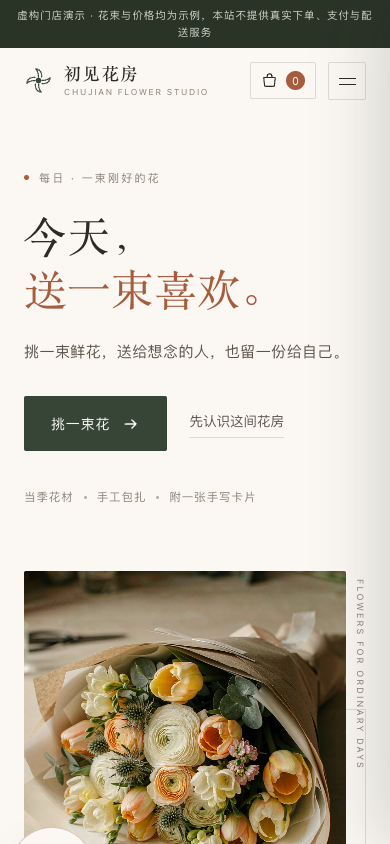
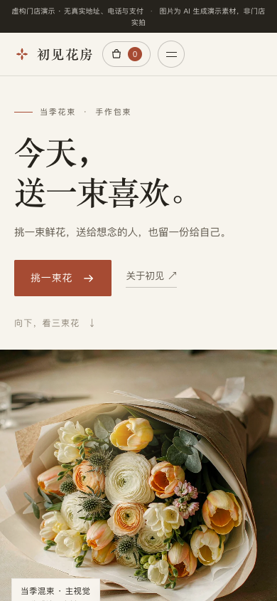
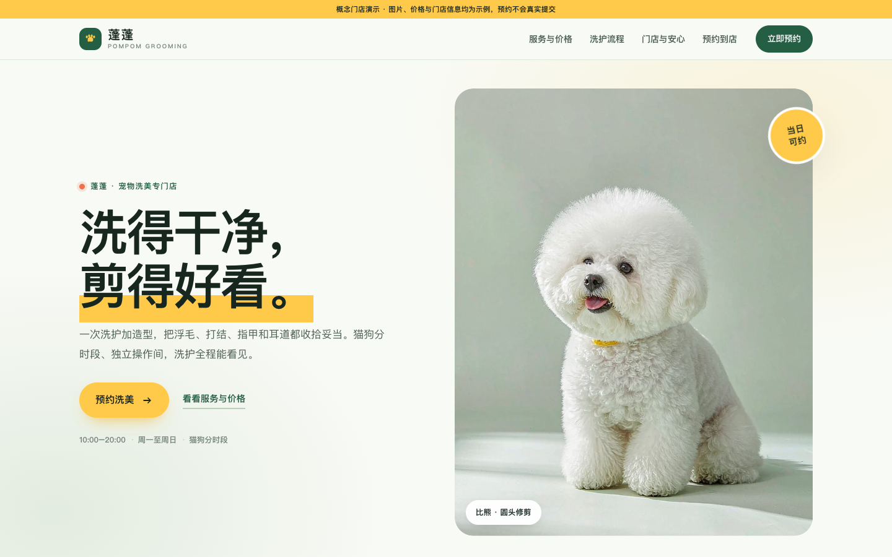
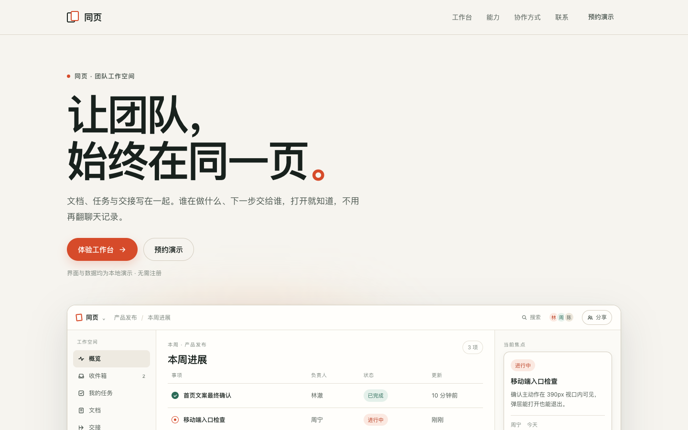

# Sitecraft 0.4.0 验证记录

这轮观察到的是**首屏主体与完整交付的局部改善**，没有证明每个行业都能稳定变漂亮，也没有证明使用 Skill 更省时。画面由 Codex 自审，未进行盲评或用户评分。技术检查通过与视觉判断分开报告。

## 怎么比较

- WorkBuddy 5.9.3，Hy4，同一台 Mac，每组一个新任务。
- 花店两组均只输入「做一个花店品牌官网」，固定品牌、首屏文案和四张花图，没有给审美反馈或代改生成代码。
- 首稿为观察器第一次发现的稳定、依赖齐全的可运行文件；不是后续修好后的版本。两端独立截图为 1440×900、390×844，等待 1500 ms，DPR 为 1；高 DPR 与跨系统画面未覆盖。
- 有 Skill 的三个任务并行运行，耗时仅描述过程，不作为严格速度基准。无 Skill 组未调用 Sitecraft，也没有读取其安装目录。
- DeepSeek 的先前试验遇到 429 中断；其中软件组曾跨模型续跑，随后旧花店与宠物任务文件也有非受控续跑变化。那些记录保留，未并入本次同模型对照。

## 鲜花首稿：相同内容，比较构图

| 无 Skill | Sitecraft 0.4.0 |
| --- | --- |
|  |  |
|  |  |

两组首稿及花店最终版的四张花图经逐一哈希核对完全一致，没有换图或二次重编码。两组首稿均无横向溢出、缺图或运行错误，主要入口可达。新版移除了圆形编号、竖排英文与图框装饰，让花束扩大并贴边；手机主图约从 y=490 开始，无 Skill 约为 y=571，主体更早出现。

两组仍都采用浅暖底和衬线标题，因此不能把这次变化写成“彻底消除 AI 味”。构图的局部改善也不等于可以保证任何题材的审美。

## 流程有没有发现实际问题

花店的后续视觉检查发现主图按固有比例把首屏撑高，下缘和说明片落到画面外。任务自行修复确定高度与手机回退，重验失效阶段，最终手机能显示完整花束。原始首稿未覆盖。

独立复核花店、宠物与软件的 `status --require-complete` 均为 true，部署 ZIP 内文件与验收目录逐一哈希匹配。花店包 415,398 B，宠物包 72,185 B，软件包 16,970 B；独立重新打开两端通过。性能数据来自本机合成测速，尚无线上用户数据。

## 跨行业检查

| 宠物洗美 | 团队协作软件 |
| --- | --- |
|  |  |

宠物页使用狗狗主图、黄色行动与粗体中文；软件页使用可操作的实际 DOM 工作台。两端基础检查通过，说明本轮没有给三个主题换同一套宋体花店包装。这两个主题未设置无 Skill 对照，不能据此作因果结论。

软件的入场、光影跟随、弹层转场均由独立浏览器采到实际变化帧；减少动态模式下光影位置保持不变。宠物首稿的过渡虽缩短，高光仍随桌面指针移动，该细节单独保留，不能以静态截图代替动态判断。

宠物任务在首稿冻结后申请追加生图，触发每张约 5–10 积分的确认。测试者两次拒绝并补充“不再生成额外图片”的约束，因此其最终交付属于有预算干预的续跑；不能称为全程无人干预的一句话交付。

宠物最终版保留了原生下拉面板视觉未验证、手机弹层提交按钮需滚动的限制；独立检查另发现桌面减少动态时高光仍跟随指针。七阶段通过不应掩盖这些边界。

## 技术验证与实际局限

- 51 项 Python 检查与 19 项 Node/浏览器检查通过，无跳过；包含真实浏览器与七阶段完整验收。
- 五种构图的两端基础检查、完整组件的菜单/表单/工作台，以及离线直接打开例子通过。
- 证据过期、缺报告、引用截图误作网站素材等情况会被阻断；自动归集不自动批准视觉判断。
- 模型仍读取了较多文档与检查器源码。花店首稿前工具调用为 71 次，无 Skill 为 19 次；这轮不能宣称执行杂务或时间已经减少。
- 本轮三个任务没有通过 `assemble --spec` 实际生成成品。因此，组装器本身的交互和回归验证已完成，其对生成任务的贡献尚未由本次对照证明。
- 0.3.0 的旧记录与本轮模型、素材和并发条件不同，不直接横比耗时或审美分数。
- 完整自动验收需要 Python、Node 和可用的 Playwright/浏览器环境。本机试验复用了已有运行时，未验证 WorkBuddy 审核沙箱或其他操作系统。

## 提审候选包

WorkBuddy 0.4.0 候选包含 55 个文件、944,646 B。独立解压后与实际测试和加载的运行包逐文件完全一致，相对文档链接检查通过。ZIP SHA-256：`5c40a7d3ec64e9694c9c2b1dfdba9920e5c20619ed94d4bb72c32378e496712f`。这是原始验证候选快照；其后仅修正发布元信息，以 0.4.1 重新提审，见[实际提交记录](0.4.1-submission.md)。

本记录不构成审核通过或普遍审美保证。提审材料应附真实限制，并允许审核者用自己的环境复现。
