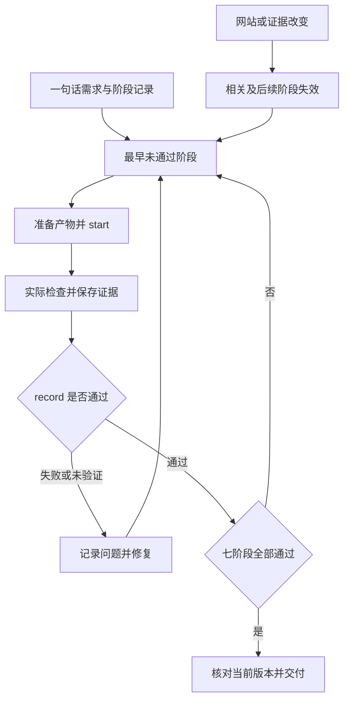

# Sitecraft · 官网设计

把一句业务描述做成可打开、有品牌感的静态官网。用户指定风格、技术栈或参考时优先沿用。普通设计决定自行完成。有足够信息就动手。用户只问方法或只要局部修改时，按当下的范围处理。用户说“用官网设计”“使用 Sitecraft”或 `$sitecraft` 即直接启用。

## 按阶段推进并保留证据

新建或整体重做时先读 [阶段产物与执行约束](references/workflow-contract.md)，用 `python3 scripts/workflow.py init` 建立记录。按需求计划、参考选型、首屏、视觉评审、整站与交互、性能、最终包七阶段推进。每阶段准备实际产物后 `start`，原生检查通过 `workflow.py check` 执行并登记实际来源，记录观察后 `record`。前置阶段未通过时修复复验；网站或证据变化会使相关及后续结果失效。最终必须由 `status --require-complete` 核对当前版本。

自动检查使用真实报告。视觉与动态评审写明观察结果，保存截图与动态中间帧。工具缺失保留未通过状态和阻塞原因。阶段通过需要证据，交付说明对应当前验收结果。

## 新站先写可打开的首屏

1. **先定视觉方向。** 用现有资料确定访客要做什么、品牌最有辨识度的内容和用户最在意的气质。已有品牌规范或指定参考优先。新项目用 [参考索引](references/design-library.md) 选一个看过的主案例，把主体、光线或材质、实际语言的排字作为一组判断。需要补某个操作时再找辅助案例。把决定写成三行可在画面中核对的要求。
2. **完成代表性首屏。** 首次写出的实际入口包含真实或明确标注的示例内容、手机布局和一个可达的主要操作。选花按钮所指的花单、预约按钮打开的演示弹层等目标内容同时写入，主图和字体同步落盘。首稿前至多主动发起一次主视觉生成。浏览器安装、批量生图、抠图返工、额外方向和设计简报放到首屏可打开之后。让主内容从第一帧可读。
3. **先查硬条件，再评画面。** 按阶段契约使用 `workflow.py check --tool browser`，传入实际主操作和已有浏览器环境，检查桌面和手机的首屏位置、目标内容、主图和所用字体。修复失败项后复验并登记，再判断图、字和构图是否一起表达用户要求。有可比旧稿时固定品牌、文案和主图，按同尺寸比较构图与排字。发现方向问题时修复并复看，通过后再扩展整站。

按 [从首屏到交付](references/delivery-workflow.md) 执行。构图、标题或关键素材存在实际取舍时，可以在首稿可开后比较候选。用户直接收到可打开的成品和简短验证说明。

## 交互与视觉表达

- 新站默认用沉浸式表达建立主题和阅读顺序。根据内容选择尺度、氛围与视觉手法。访客的主要任务始终清楚，手机重新安排阅读顺序、图像裁切和操作位置。
- 新建或整体重做官网分别设计场景动效、真实状态的连续转场、与场景相符的动态光影，按主题控制强度。尊重用户指定的静态风格和减少动态效果设置。存在下拉、菜单和弹层时，检查打开、选中、键盘焦点及关闭。默认用一致的 SVG 或项目图标，保留用户提供或明确指定的 Emoji。
- 真实 3D、角色跟随和可旋转产品读 [3D 实现](references/web-3d.md)。先保留可用的静态画面，再增强场景并检查触控、性能和回退。
- 有真实材料时优先使用。品牌名、项目或示例内容可在资料缺失时合理拟定。示例价格、门店和预约应在使用位置清楚标注；真实口碑、客户、资质和交易以用户提供的事实为准。

## 按问题找参考

- 需要找一张实图时看 [参考索引](references/design-library.md)。需要改构图或排字时看 [构图方法](references/design-playbook.md) 与 [视觉选择](references/visual-selection.md)。
- 沉浸式表达见 [沉浸体验](references/immersive-experiences.md)，实际动态状态见 [动效与控件](references/motion-and-controls.md)。整页复查看 [视觉验收](references/visual-review.md)。
- 交付静态部署包时按 [静态发布检查](references/static-release.md) 优化图片、核对归档、从最终包预览并用现有工具测首页。离线单文件按断网可打开验收；缺工具的检查明确标记待验证。网站发布按用户授权处理。
- 素材使用范围见 [素材许可](references/asset-notices.md)。

维护本 Skill 时可用 [evals/scenarios.json](evals/scenarios.json) 做有针对性的行为回归。普通建站任务直接按上面的步骤执行。
