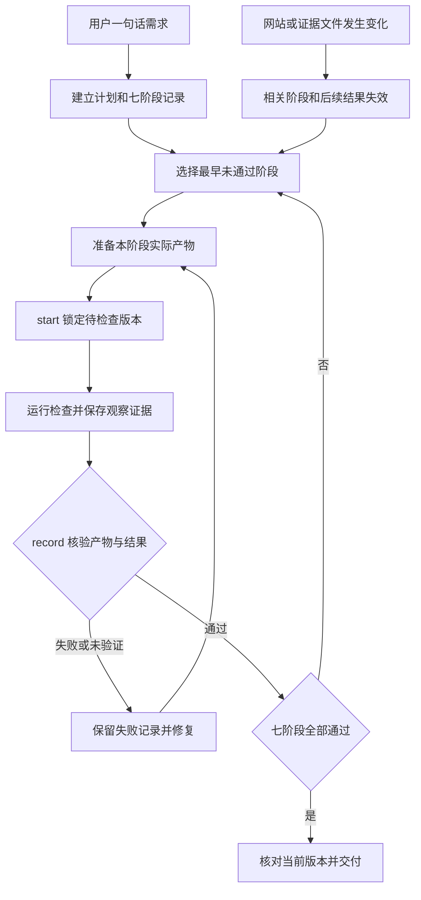

# 阶段产物与执行约束

新建或整体重做官网时使用本流程。用户的一句话保留为原始需求，AI 完成计划、实现和检查。局部修改沿用相关验收，不为修一个按钮扩展成整站制作。以下命令由 AI 执行，用户无需填写技术表格。

## 推进与返工



阶段按 `brief → references → first-screen → visual → site → performance → delivery` 推进。每阶段均提交实际文件和检查结果。缺产物、未验证、失败、过期记录都会阻止后续阶段。修复后重新 `start`、执行检查、`record`，保留每次尝试。

| 阶段 | 必需产物 | 通过条件 |
| --- | --- | --- |
| brief 需求计划 | `brief` JSON | 原始需求、受众、页面标题、主要动作、内容、明确约束、效果范围和性能预算齐全，核对用户原话 |
| references 参考选型 | `reference_notes` JSON、`reference_capture` 实图 | 记录真实来源、实际观察，以及主图、光线、字体和构图如何借鉴 |
| first-screen 首屏 | `entry`、`browser_report` JSON 及其两张截图 | 两视口主操作实际可达，标题和按钮首屏可见，资源与运行检查通过，另查背景主图与实际字形 |
| visual 视觉评审 | `desktop`、`mobile` PNG | 看图记录品牌气质、层级与手机裁切的具体观察，有问题修复并复看 |
| site 整站与交互 | `entry`、`desktop_full`、`mobile_full` PNG、`interaction_log`、完整 `browser_report` | 整页、手机、控件、减少动态效果及适用的 Motion、转场、光影、WebGL 检查通过 |
| performance 首页速度 | `mobile_report`、`desktop_report` JSON | 每端至少三次冷访问、一次热访问；标题正确、请求与运行无错误、观测完整，全部样本符合计划预算 |
| delivery 最终包 | `package`、`audit_report`、`preview_audit`、`package_preview`、`handoff` | 包审计通过、SHA 与当前目录相符；从独立解压目录复验画面与主操作，图片画质和使用说明有实际记录 |

`template` 生成每阶段所需的字段和检查项。填写 `checks` 时记录实际观察，`evidence` 引用同一报告的产物名称。`reviewer` 记录执行评审的 AI 或人员。空说明和缺失证据都无法登记通过。不能复制“通过”填满清单后宣称完成评审。

## 初始化并完成一个阶段

QA 目录与待发布目录分开，避免记录进入公开网站。`--site` 指向最终静态目录，不指向带开发依赖的源码项目。

```sh
python3 /path/to/sitecraft/scripts/workflow.py init \
  --site release/site --out qa/sitecraft --request '做一个花店品牌官网'

python3 /path/to/sitecraft/scripts/workflow.py template --stage brief > qa/brief-result.json
```

先准备需求计划等实际产物，再开始本阶段检查。`start` 记录检查开始时间与网站版本。随后执行检查、写入阶段结果，最后登记。

```sh
python3 /path/to/sitecraft/scripts/workflow.py start --run qa/sitecraft --stage brief
# 核对计划与用户原话，填写 qa/brief-result.json 中的实际观察和产物路径。
python3 /path/to/sitecraft/scripts/workflow.py record \
  --run qa/sitecraft --stage brief --evidence qa/brief-result.json
python3 /path/to/sitecraft/scripts/workflow.py status --run qa/sitecraft
```

`record` 遇到失败退出 1，记录失败原因；修改产物后重复 `start → 检查 → record`。前置阶段未通过时，`start` 拒绝跳步。阶段结果 JSON 必须在本次 `start` 后写入。浏览器、测速、审计通过下面的 `check` 命令执行，工具登记本次实际报告、来源目录和文件 SHA。复制旧文件、手写原生报告、修改采集结果都不能替代本次检查。

报告内的文件路径相对该报告解析，亦可用本地绝对路径。`checks.*.evidence` 使用产物名称，例如 `desktop`、`mobile`，无需重复路径。所有登记的文件和嵌套截图都计算 SHA-256。

## 需求计划格式

下面仅示意数据结构，内容由当前任务决定。`title` 用于核对浏览器和测速打开的是目标页面。预算在测量前按站点类型确定，单位分别为毫秒、无量纲 CLS、字节。

```json
{
  "request": "做一个花店品牌官网",
  "audience": "附近选花和送礼的顾客",
  "title": "本项目实际品牌名",
  "primary_action": "查看可选花束",
  "content": ["当季花束", "服务方式", "联系门店"],
  "constraints": [],
  "features": {
    "motion": {"enabled": true},
    "transition": {"enabled": true},
    "lighting": {"enabled": true},
    "webgl": {"enabled": false, "reason": "本次采用摄影主体与轻量空间效果"}
  },
  "budgets": {"lcp_ms": 2500, "cls": 0.1, "transfer_bytes": 1048576}
}
```

效果范围在计划阶段确定。明确无动画的需求可以关闭对应效果，并在 `reason` 解释约束，在 `source_quote` 填原始请求中对应的原文。工具要求这段引文确实出现在原始请求中；执行评审还须核对其含义。默认新官网的 Motion、转场、光影按主题实现。关闭 WebGL 可以选择其他合适表达。整站阶段中，已关闭的效果以 `not_applicable` 加理由记录；已开启的效果必须实测通过。缺工具、实现困难或赶时间都不能作为效果不适用的理由。

## 浏览器与动态证据

阶段工具使用已有 Node、Playwright 与 Chromium，自动启动当前静态目录的临时本地 HTTP 服务，结束后关闭服务。原生脚本保持可以独立使用，阶段登记仅接受 `workflow.py check` 实际执行并记录的结果。

```sh
python3 /path/to/sitecraft/scripts/workflow.py start --run qa/sitecraft --stage first-screen
python3 /path/to/sitecraft/scripts/workflow.py check --run qa/sitecraft \
  --tool browser --primary '.hero a.primary' --primary-target '#flowers' \
  --playwright-module /project/node_modules/playwright
```

`check` 返回报告的实际路径，将其填入阶段结果的 `browser_report`。报告同目录的 `desktop.png`、`mobile.png` 是实际截图。首屏和视觉阶段自动执行初始两视口检查；整站阶段执行含减少动态效果的完整检查，必须提供 `--primary-target`。每次需要截图证据的阶段都实际调用本次检查。视觉阶段使用本次截图填写 `desktop`、`mobile`，再实际看图记录观察。页内链接也可用 `--primary-target '#flowers'` 指定目标。

性能阶段分别执行 `--tool mobile` 和 `--tool desktop`，自动采集三次冷访问和一次热访问。可用 `--channel chrome` 复用已有浏览器。

```sh
python3 /path/to/sitecraft/scripts/workflow.py check --run qa/sitecraft \
  --tool mobile --playwright-module /project/node_modules/playwright
python3 /path/to/sitecraft/scripts/workflow.py check --run qa/sitecraft \
  --tool desktop --playwright-module /project/node_modules/playwright
```

视觉评审看实际 PNG。交互记录写明动作、预期、观察结果与截图，覆盖页面实际控件的打开、选中、关闭、键盘和焦点恢复。`reduced-motion` 环境的基础报告只证明页面可用，还要观察效果是否按偏好减少。真实 3D 另查触控、回退与资源失败路径。

启用动态效果时先写触发计划，再通过本阶段的 `check --tool browser --motion-plan qa/motion-plan.json` 实际采集。以下为触发计划示例，`transition` 和 `lighting` 各填写真实动作，已关闭的效果省略。

```json
{
  "motion": {
    "trigger": "观察主场景自动运动",
    "desktop": {"type": "load"},
    "mobile": {"type": "load"}
  },
  "transition": {
    "trigger": "打开演示预约面板",
    "desktop": {"type": "click", "selector": ".booking-button"},
    "mobile": {"type": "click", "selector": ".booking-button"}
  },
  "lighting": {
    "trigger": "主场景光线变化",
    "desktop": {"type": "pointer", "x": 0.8, "y": 0.3},
    "mobile": {"type": "click", "selector": ".lighting-toggle"}
  }
}
```

支持 `load`、`click`、`hover`、`scroll`、`pointer`。需要选择元素的动作提供真实 `selector`，指针坐标是视口 0–1 比例。按实际效果选择触发动作，别为通过测试新增无业务意义的控件。每项效果重新加载页面，在触发后的起始、约 120ms、约 360ms 采样，JSON 记录实际采样时间。浏览器报告目录中的 `motion-capture.json` 填入阶段产物 `motion_capture`，其桌面、手机每组至少三帧、时间递增且包含不同画面。示例结果如下。

```json
{
  "motion": {
    "trigger": "本次实际执行的指针、触控或场景动作",
    "desktop": [
      {"ms": 0, "file": "motion-desktop-0.png"},
      {"ms": 120, "file": "motion-desktop-120.png"},
      {"ms": 360, "file": "motion-desktop-360.png"}
    ],
    "mobile": [
      {"ms": 0, "file": "motion-mobile-0.png"},
      {"ms": 120, "file": "motion-mobile-120.png"},
      {"ms": 360, "file": "motion-mobile-360.png"}
    ]
  }
}
```

可以附录屏作为进一步观察证据。帧文件存在和发生变化只证明可复查的状态序列；流畅度、设计合适程度仍须实际观察并写入阶段检查。需要更长进程时另补真实录屏或连续帧观察。无法观察时保留 `unverified`，不能登记通过。

## 版本变化、测速与交付

- 扩展整页、优化图片或调整代码后，网站 SHA 会变化，首屏及后续阶段变为过期。先完成准备工作，再重跑当前版本的首屏和视觉检查，然后登记整站、测速、交付。复验针对同一最终版本，避免拿旧截图搭配新包。
- `start` 到 `record` 期间网站改变，本次结果不能通过。证据文件后续改变或删除，也会使所属阶段和后续结果失效。失败尝试保留在 `workflow.json` 的 `attempts` 中。工具退出或会话中断后从 `status` 的 `next_stage` 继续。
- 测速沿用 [静态发布检查](static-release.md)，报告 `measured` 后还要逐个样本核对预算、缺失指标、请求完整性和错误。超预算先优化再复测。预算确实不合适时修改计划并说明依据，相关阶段重新验收。
- 交付前优化、构建与归档，用 `check --tool audit --package release/site.zip --image-log qa/images.json` 严格审计。解压到独立目录后，用 `check --tool preview-audit --preview-root qa/extracted --package release/site.zip --image-log qa/images.json` 保存第二份审计。带目录前缀的归档加 `--archive-prefix`。两份报告的文件 SHA 与当前发布目录必须一致。
- 使用 `check --tool preview --preview-root qa/extracted --primary '.hero a.primary' --primary-target '#flowers' --playwright-module /project/node_modules/playwright`，工具实际启动独立目录并复验，生成 `package_preview`。QA 证据保留在网站根目录外。
- 离线单 HTML 使用 `init --delivery html`，交付文件必须是发布目录中的 `index.html`，目录内只有该文件且无外部引用。审计命令省略 `--package`，`archive_not_checked` 按范围不适用。复制 HTML 到独立目录验证断网可开、再做浏览器与本地 HTTP 测速，分别说明验证环境。
- 大型内嵌素材产生 `inline_asset_needs_review` 时，补 `inline_review` JSON，记录 `status: pass`、具体压缩与画质观察 `detail`，以及 `evidence` 中的记录/截图文件路径。工具检查文件并保留原生 warning，在有实际复核证据时解决该待审项。其他 warning 仍阻断，错误必须修复复验。
- 检查依赖不可用时先使用已有环境或一次可用替代，记录真实状态。缺少阶段工具所需环境时，现有浏览器的额外观察可以随当前产物交付；阶段保持未通过，并提供阻塞原因。不能用手写通过报告取得本次检查登记。

完成前必须执行下面的命令。退出 0 才能称七阶段流程完成。

```sh
python3 /path/to/sitecraft/scripts/workflow.py status --run qa/sitecraft --require-complete
```

交付可打开的网页、最终包和简短验收结果，并提供 QA 记录入口。阶段工具核验顺序、文件、版本和声明的检查结果；审美与流畅度结论由实际评审承担。文件可写的 Agent 仍须遵守工具调用和真实记录要求。

`workflow.py` 使用独占写锁和原子替换保存状态。并发命令持锁时会拒绝第二个写入。异常退出留下锁时，先确认对应任务已停止，再删除 QA 目录的 `.workflow.lock` 后继续。
